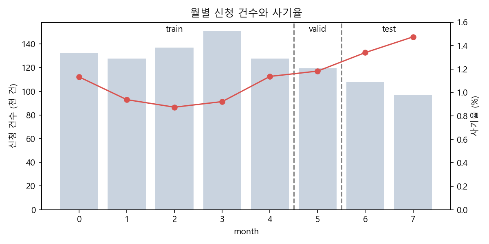
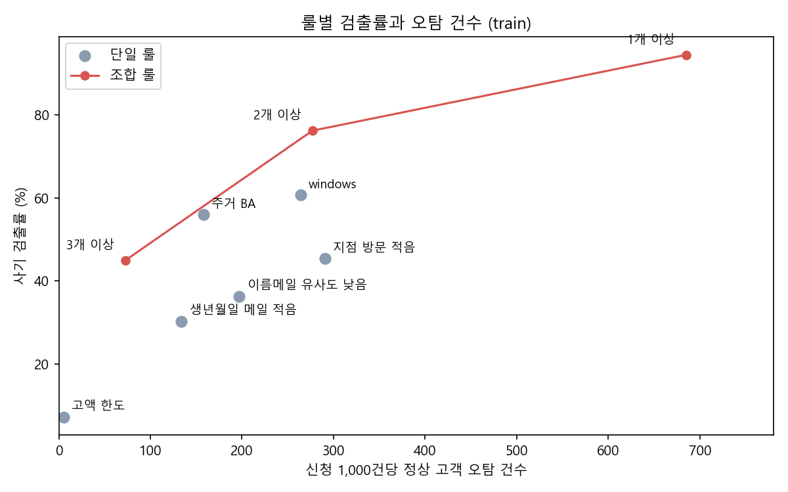
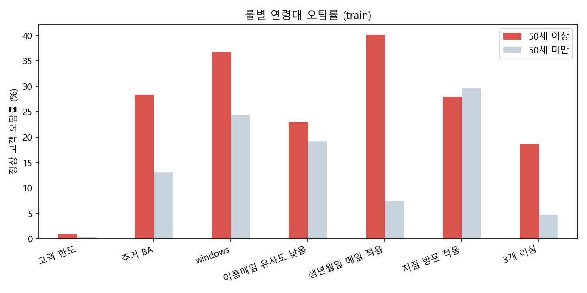
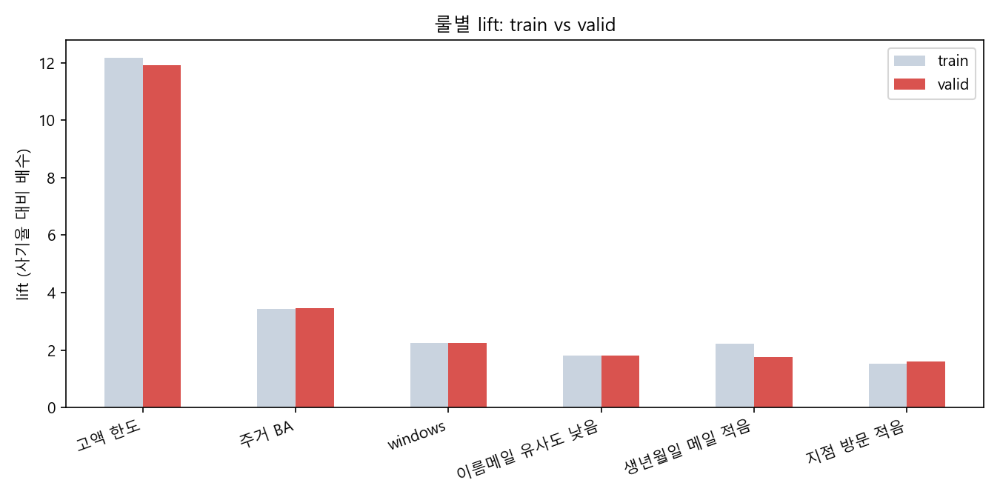
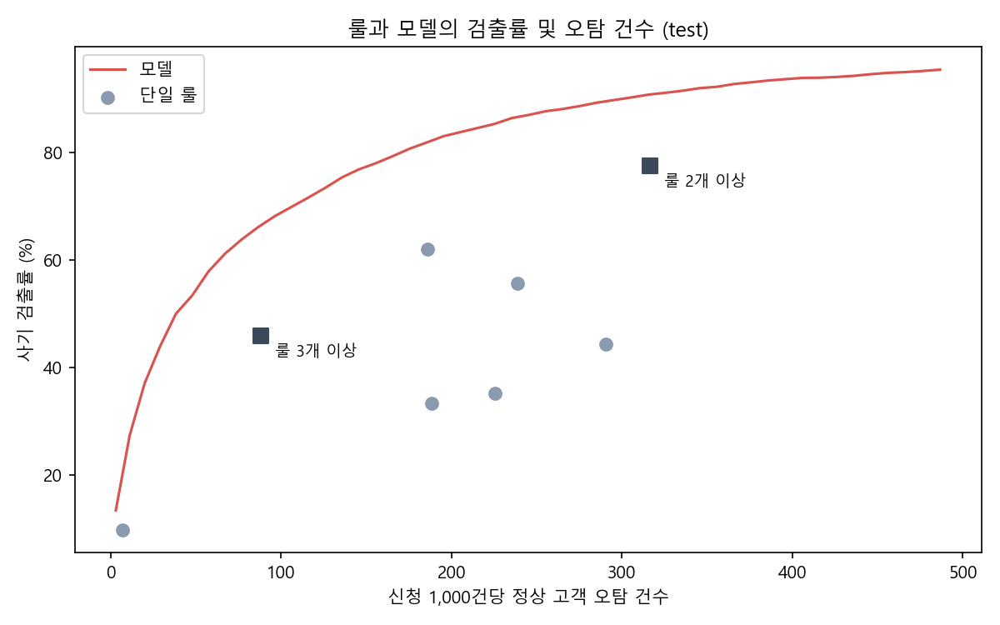
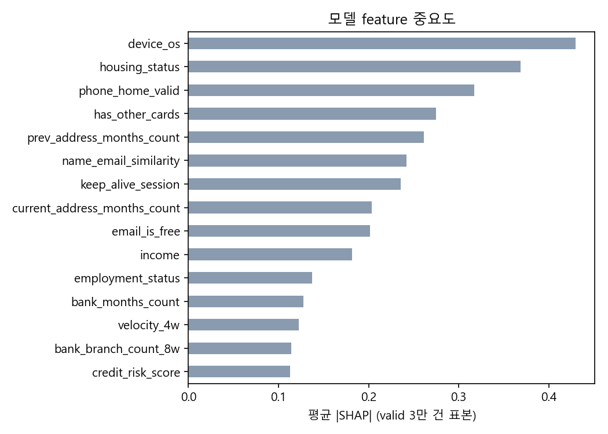
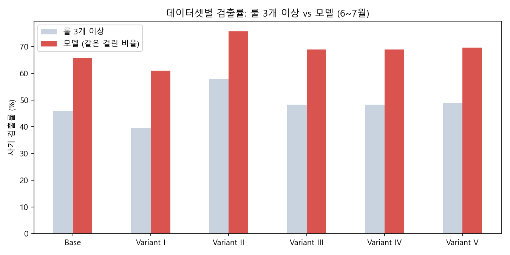

# bank-account-fraud-rule-evaluation

계좌 개설 사기 탐지 룰의 성능 측정과 LightGBM 모델 보완 효과 검증 (BAF Dataset Suite 기반)

## 문제 정의

- 비대면 계좌 개설 구간의 사기 신청은 재산 손실과 법적 리스크로 이어지고, 정상 고객 오탐은 계좌 개설 거절로 직결되는 구조
- 룰 단독 운영 시 검출률과 오탐 수준, 시간 경과에 따른 룰 성능 유지 여부, 모델 보완 효과의 정량 확인 필요
- 연령대별 사기율 격차가 커서 룰과 모델의 연령대별 오탐 격차까지 함께 측정
- 데이터: BAF Dataset Suite (NeurIPS 2022), 100만 건, 사기 비율 1.1%, 신청 월 컬럼 보유로 시간 순서 검증 가능, Base와 Variant 5종 제공으로 분포 변화 검증 가능
- 평가 원칙: 월 기준 시간 순서 분할, 룰 임계값과 언더샘플링은 train에만 적용, 컷오프는 valid에서 결정, test는 최종 1회 평가

## 가설 검증 및 실험

### 데이터 구성

- 1,000,000건, 32컬럼, 사기 11,029건 (1.10%)
- 신청 건수는 3월 약 15.1만 건을 정점으로 7월 약 9.7만 건까지 감소, 사기율은 2월 0.87%에서 7월 1.47%로 상승
- 후반 구간일수록 사기 비율이 높아 같은 임계값에서도 precision이 달라지므로 시간 순서 분할 채택

| 구간 | 월 | 신청 건수 | 사기 건수 | 사기율 |
|---|---|---|---|---|
| train | 0~4 | 675,666 | 6,740 | 1.00% |
| valid | 5 | 119,323 | 1,411 | 1.18% |
| test | 6~7 | 205,011 | 2,878 | 1.40% |



- 월별 추이와 분할 경계를 한 장에 표시해 시간 분할 근거 제시
- 50세 이상은 신청의 18.3%, 사기의 38.9% 차지, 룰과 모델 모두 연령대별 오탐률 분리 산출


- 전처리: 결측을 -1로 표기한 5개 컬럼은 결측값으로 변환, month는 분할 기준이라 feature에서 제외, intended_balcon_amount는 음수가 74%이고 값의 의미가 불명확해 제외

### 룰 베이스라인

- 가설 1: 단순 임계값 룰은 사기 일부만 검출하며, 검출률을 높일수록 오탐 급증
- train EDA에서 사기율이 높았던 신호로 단일 룰 6개 정의, 임계값은 train 기준으로 확정
  - 고액 한도 1,900 이상, 주거 유형 BA, windows OS, 이름-메일 유사도 0.18 미만, 생년월일당 메일 수 4 이하, 지점 방문 수 1 이하
- 단일 룰: lift 1.5~12.2배, 검출률 7~61%, 신청 1,000건당 오탐 5~290건
- 고액 한도는 precision 12%로 정밀하나 검출률 7%, 나머지 룰은 검출률 30~61%이나 오탐 130~290건
- 룰 조합(해당 룰 N개 이상), train 기준

| 조합 | 걸린 비율 | 검출률 | 1,000건당 오탐 | 오탐률 (50세 이상 / 미만) |
|---|---|---|---|---|
| 1개 이상 | 69.4% | 94.5% | 684.8 | 84.2% / 65.7% |
| 2개 이상 | 28.5% | 76.2% | 276.9 | 49.7% / 23.0% |
| 3개 이상 | 7.7% | 45.0% | 72.8 | 18.7% / 4.7% |



- 어떤 룰도 높은 검출률과 낮은 오탐을 동시에 달성하지 못하는 교환관계 확인
- 연령 편중: 생년월일당 메일 수 룰의 50세 이상 오탐률 40%, 미만 7%



- 임계값 고정 후 valid 적용: 단일 룰 6개 중 5개는 lift 유지, 생년월일당 메일 수 룰만 2.21에서 1.75로 하락
- valid 3개 이상 조합: 걸린 비율 7.0%, 검출률 41.7%, 1,000건당 오탐 64.8건



### 모델 보완

- 가설 2: LightGBM은 같은 걸린 비율에서 룰보다 사기를 더 많이 검출
- feature 29개 (범주형 5개), -1 결측값은 결측 처리
- 언더샘플링(정상 신청 100% / 30% / 10%): valid PR-AUC 0.191 / 0.191 / 0.193으로 차이 미미, 최종 모델은 10% 설정
- 컷오프: valid에서 룰 2개·3개 이상과 걸린 비율이 같아지도록 결정, test에는 그대로 적용
- test 성능: PR-AUC 0.195, ROC-AUC 0.893 (valid 0.193, 0.896)
- test 사기율 1.4% 기준 PR-AUC는 기준선의 약 14배

| 걸린 비율 | 방식 | 검출률 | precision | 1,000건당 오탐 |
|---|---|---|---|---|
| 약 9.5% | 룰 3개 이상 | 45.8% | 6.8% | 88.3 |
| 약 9.5% | 모델 | 65.8% | 9.8% | 85.5 |
| 약 32.8% | 룰 2개 이상 | 77.6% | 3.3% | 316.7 |
| 약 32.8% | 모델 | 90.8% | 3.9% | 314.8 |



- valid 컷오프를 그대로 적용하면 모델은 8.3%를 걸러 검출률 63.2%, 룰은 9.5%를 걸러 45.8%
- valid에서 test로 갈 때 걸린 비율 증가폭: 룰 7.0%에서 9.5%, 모델 7.0%에서 8.3%
- 50세 이상 대 미만 오탐률 비율: 룰 약 3.0배, 모델 약 2.7배로 격차 잔존
- 중요도 상위 feature: device_os, housing_status, phone_home_valid, has_other_cards, prev_address_months_count
- phone_home_valid, has_other_cards, keep_alive_session, email_is_free는 현재 룰에 없는 신호로 룰 개선 후보



### 분포 변화 검증

- 가설 3: Base 기준으로 만든 룰과 모델은 분포가 다른 Variant에서도 모델 우위 유지
- Base 기준 임계값과 컷오프를 고정한 채 Variant I~V의 6~7월에 적용
- 같은 걸린 비율에서 룰 3개 이상 대비 모델 검출률이 전 데이터셋에서 17.9~21.4%p 높음

| 데이터셋 | 룰 3개 이상 | 모델 |
|---|---|---|
| Base | 45.8% | 65.8% |
| Variant I | 39.5% | 60.9% |
| Variant II | 57.8% | 75.7% |
| Variant III | 48.2% | 68.9% |
| Variant IV | 48.2% | 68.9% |
| Variant V | 48.9% | 69.5% |



- 룰이 걸러내는 비율은 Base 9.5%에서 Variant II~V 약 14%로 상승, 임계값 재보정 필요
- 생년월일당 메일 수 룰 lift: Base 1.53, I 1.15, II 1.54, III·IV 1.14, V 1.18
- Variant III과 IV는 6~7월 공통 32컬럼 기준 행 순서만 다른 동일 데이터, 하나의 결과로 집계 (III은 추가 컬럼 x1, x2 보유, 모델과 룰에서 미사용)
- 50세 이상 대 미만 오탐률 비율: 룰 약 3.0~3.1배, 모델 약 2.7배로 전 데이터셋 유지
- 한계: Base에서 학습한 모델의 강건성 확인, Variant 자체 학습 구간 재학습은 미수행

## 결과

- 같은 양을 걸러낼 때 룰 3개 이상 대비 모델 검출률 +20%p (신청의 약 9.5% 심사 시 사기 45.8%에서 65.8% 검출)
- 모델 precision은 약 10%로 걸린 신청의 약 90%는 정상 고객, 자동 거절보다 추가 인증과 수동 심사 대상 분류에 적합
- 모델 컷오프 기준 걸린 비율이 룰보다 덜 증가, 사기율 상승 구간에서 심사 대기열 증가폭 억제
- 룰 성능은 임계값 고정 시 시간 경과와 분포 변화에 따라 하락하는 룰 존재 (생년월일당 메일 수)
- 연령 편중은 모델 도입 후에도 잔존, 오탐률 50세 이상이 미만의 약 2.7배

### 운영 제안

- 모델 점수 상위 약 8~9% 신청을 추가 인증과 수동 심사 대상으로 지정
- 고액 한도 룰은 소량·고정밀 단독 룰로 유지, 생년월일당 메일 수 룰은 재점검 대상
- 사기율 변화에 맞춘 모델 컷오프 정기 재보정
- 연령대별 오탐률 모니터링 (50세 이상 정상 고객의 불필요한 추가 인증 부담)
- 중요도 상위이나 룰에 없는 신호(phone_home_valid, has_other_cards 등)를 룰 후보로 추가

## 폴더 구조

```
bank-account-fraud-rule-evaluation/
├── data/
├── images/
├── notebooks/
│   ├── 01_eda.ipynb
│   ├── 02_rule_baseline.ipynb
│   ├── 03_model.ipynb
│   └── 04_variant_check.ipynb
├── results/
└── README.md
```

## 재현 방법

- 데이터: Kaggle Bank Account Fraud Dataset Suite (NeurIPS 2022) 다운로드 후 `data/raw/`에 Base.csv와 Variant I~V.csv 배치 (git 제외 대상)
- 실행 순서: `notebooks/01` → `04`, 01에서 `data/processed/base.parquet` 생성, 03에서 `results/scores.parquet`과 모델 저장